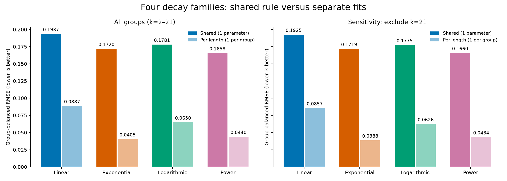
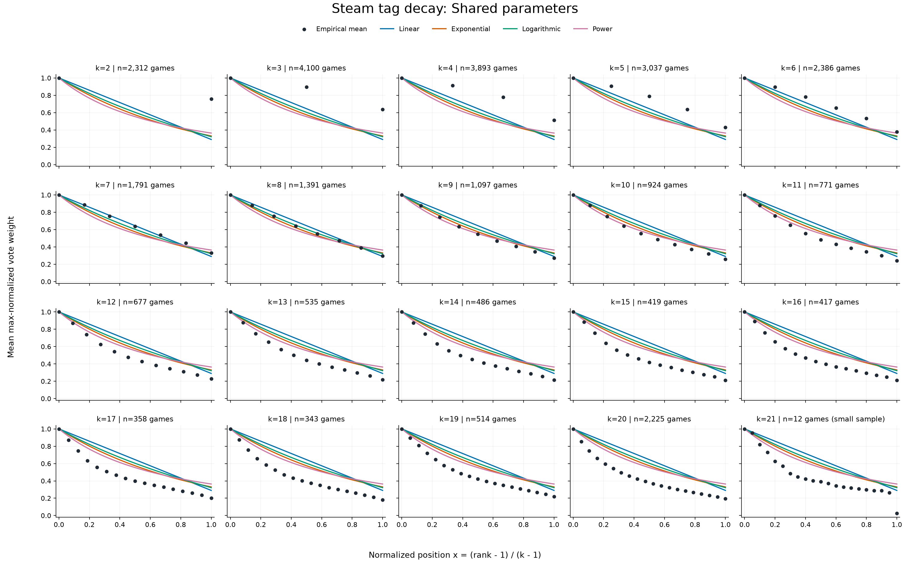
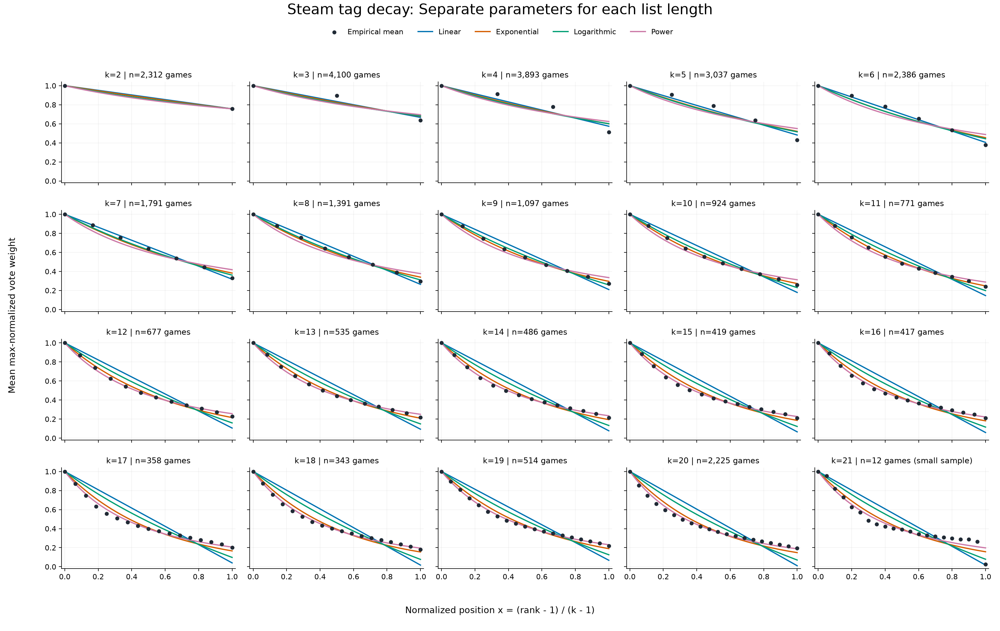

# Steam tag decay results

Selected shared curve: **power**, `w(r,k) = (1+x)^(-p)`, with `p=1.458500902` and `x=(r-1)/(k-1)`.

The best straight line under the same weighting objective is **w = 1 - 0.7098613871 x**. Its intercept is fixed at 1; it is constrained to remain nonnegative.

## Shared-model comparison

| Rank | Family | Parameter | Group MSE | Group RMSE | Sample-weighted MSE | Sample-weighted RMSE |
|---:|---|---:|---:|---:|---:|---:|
| 1 | power | 1.4585009 | 0.027495339 | 0.165817 | 0.045294948 | 0.212826 |
| 2 | exponential | 1.10703782 | 0.029571824 | 0.171965 | 0.047302627 | 0.217492 |
| 3 | logarithmic | 0.678219506 | 0.031728297 | 0.178124 | 0.046409252 | 0.215428 |
| 4 | linear | 0.709861387 | 0.037505874 | 0.193664 | 0.049470994 | 0.222421 |

The winner reduces group-balanced MSE by 7.02% relative to the runner-up. The sample-size-weighted winner is **power**. Each shared family has one fitted parameter, so there is no parameter-count advantage between them.

## Shared versus separate fits

| Family | Shared RMSE | Per-length RMSE | MSE reduction |
|---|---:|---:|---:|
| power | 0.165817 | 0.043965 | 92.97% |
| exponential | 0.171965 | 0.040460 | 94.46% |
| logarithmic | 0.178124 | 0.064976 | 86.69% |
| linear | 0.193664 | 0.088749 | 79.00% |

The lowest-error per-length family is **exponential**. Separate fits use 20 parameters per family, compared with one for the shared rule. These are descriptive training fits; the lower error does not establish better generalization.

A single normalized-position curve forces the same last-rank weight at every list length. The empirical last-rank means vary considerably with length, so the shared winner is a substantial compromise. Prefer the per-length results when the objective is descriptive accuracy for the observed lengths, and use the shared winner when one compact rule is required.

## Sensitivity to the 21-tag group

The k=21 group contains only 12 games, and its last-rank mean is unusually low. All shared models were refitted after excluding that group.

| Family | Group RMSE without k=21 | Sample-weighted RMSE without k=21 |
|---|---:|---:|
| power | 0.165978 | 0.208571 |
| exponential | 0.171947 | 0.212980 |
| logarithmic | 0.177525 | 0.211126 |
| linear | 0.192541 | 0.218034 |

Winner without k=21: **power**. Winner changed: **no**. The full-data winner remains the saved selection; the group is not silently discarded.

## Metrics, verification, and limits

For each k, MSE_k = mean((prediction - empirical_mean)^2) over ranks 2…k. Group-balanced MSE is the unweighted mean of MSE_k. Sample-weighted MSE is sum(N_k*MSE_k)/sum(N_k). Each RMSE is the square root of its corresponding aggregated MSE; it is not an average of per-group RMSEs. Shared fits minimize group-balanced MSE; sample weighting evaluates those same fitted parameters rather than refitting them.

Verified 29,022 source records against the indexed CSV; maximum recomputed empirical-mean difference: 0. Zero-tag and singleton groups carry no decay information and are excluded from scores. Rank 1 is plotted but excluded from every score.

This selects the closest curve among the four specified families, under normalized position and the stated metric. It does not establish recommendation quality, causal tag importance, or an optimal curve among all possible functions. No uncertainty intervals or held-out recommendation evaluation were performed. The tail anomaly in k=21 and variation across list lengths remain visible in the plots.

Lists above 21 use the same formula at normalized positions and are extrapolations. The function does not clamp/truncate lists or apply L2 normalization. Genres, categories, and main preprocessing features are not changed.

## Plots

See model_scores.csv, fitted_parameters.csv, per_group_errors.csv, predictions.csv, empirical_targets.csv, selected_model.json, and run_manifest.json for reusable results.
