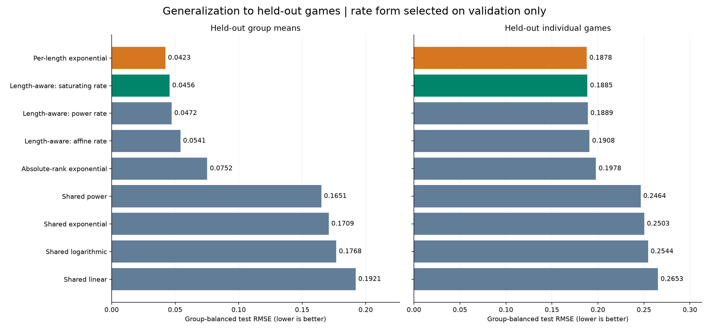
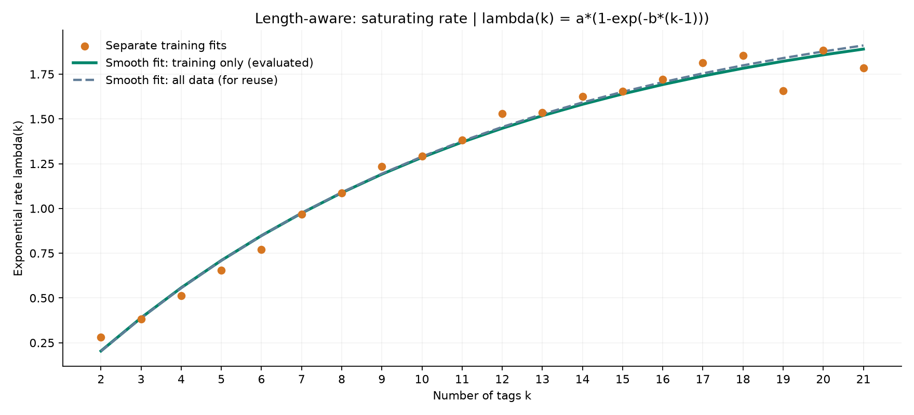
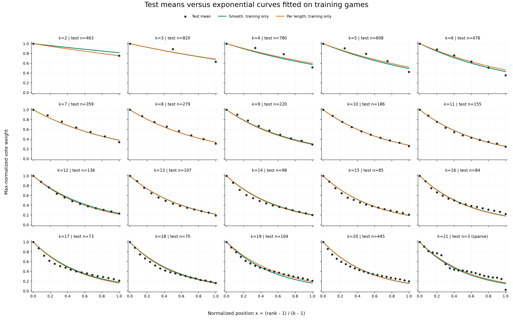

# Length-aware exponential decay: generalization experiment

Validation-selected smooth model: **Length-aware: saturating rate**. `lambda(k) = a*(1-exp(-b*(k-1)))`; `w(r,k)=exp(-lambda(k)*(r-1)/(k-1))`.

Training-only evaluation parameters: `{"a": 2.2072768579717916, "b": 0.0969780937258659}`.

All-data parameters for reuse: `{"a": 2.249150856857026, "b": 0.0946333263878718}`. The reported holdout scores do not evaluate this all-data refit.

## Protocol

Seed **20261023**. Sort by AppID, then randomly split games independently within every length into floor(60%*N) training, floor(20%*N) validation, and the remainder test. All tags/ranks from one game stay together. Zero-tag and singleton games are excluded from decay scores.

| Split | Games | Lengths | Games at k=21 |
|---|---:|---:|---:|
| train | 16,605 | 20 | 7 |
| validation | 5,530 | 20 | 2 |
| test | 5,553 | 20 | 3 |

Normalize each game's positive vote counts by that game's first count. Fit models to training means only, minimizing the unweighted mean of within-length MSEs over ranks 2…k. Validation selects the smooth rate form by held-out mean-curve group-balanced MSE. All nine candidates are frozen before test scoring; neither test means nor full-data means are passed to their fits. The best validation candidate across all models is **Per-length exponential**. Test results do not change that selection.

Three smooth candidates have two nonnegative parameters: affine `a+b*(k-1)`, power `a*(k-1)^b` with `0<=b<=1`, and saturating `a*(1-exp(-b*(k-1)))`. The one-parameter absolute-rank baseline has `lambda(k)=beta*(k-1)`, equivalently `w=exp(-beta*(r-1))`. Shared original families each have one parameter; independent exponential fits have one parameter per observed length.

## Validation comparison

| Model | Parameters | Mean-curve macro RMSE | Individual-game macro RMSE |
|---|---:|---:|---:|
| Per-length exponential | 20 | 0.045477 | 0.188561 |
| Length-aware: saturating rate **(selected smooth)** | 2 | 0.047297 | 0.189008 |
| Length-aware: power rate | 2 | 0.047512 | 0.189062 |
| Length-aware: affine rate | 2 | 0.052784 | 0.190456 |
| Absolute-rank exponential | 1 | 0.069956 | 0.195911 |
| Shared power | 1 | 0.172858 | 0.251728 |
| Shared exponential | 1 | 0.178811 | 0.255853 |
| Shared logarithmic | 1 | 0.185258 | 0.260399 |
| Shared linear | 1 | 0.200769 | 0.271653 |

## Held-out test comparison

| Model | Parameters | Mean-curve macro RMSE | Individual-game macro RMSE |
|---|---:|---:|---:|
| Per-length exponential | 20 | 0.042258 | 0.187755 |
| Length-aware: saturating rate **(selected smooth)** | 2 | 0.045610 | 0.188538 |
| Length-aware: power rate | 2 | 0.047241 | 0.188938 |
| Length-aware: affine rate | 2 | 0.054143 | 0.190781 |
| Absolute-rank exponential | 1 | 0.075244 | 0.197807 |
| Shared power | 1 | 0.165070 | 0.246402 |
| Shared exponential | 1 | 0.170874 | 0.250328 |
| Shared logarithmic | 1 | 0.176841 | 0.254438 |
| Shared linear | 1 | 0.192087 | 0.265261 |

Selected smooth minus per-length exponential test mean-curve MSE: **+0.00029458**. Positive values favor separate rates; negative values favor the smooth rate. Compare the absolute errors as well as the parameter counts when choosing the practical rule.

## Test uncertainty and sparse-length sensitivity

| Test scoring | Smooth RMSE | Per-length RMSE | Paired MSE difference | Conditional 95% interval |
|---|---:|---:|---:|---|
| all_lengths | 0.045610 | 0.042258 | +0.00029458 | [+0.00005653, +0.00054576] |
| without_k21 | 0.044208 | 0.041151 | +0.00026094 | [+0.00005605, +0.00048300] |

Paired bootstrap: 2,000 resamples of test games within each length, with fixed fitted curves. Intervals cover test-sampling uncertainty only, conditional on training and validation choices. Rescoring without k=21 uses the same fitted models; it neither refits models nor changes the selected rate form. Only three k=21 games are in test, so its mean and uncertainty remain poorly estimated.

## Generalization to omitted lengths

With the validation-selected rate form fixed, omit each length from training, refit the two parameters on the other lengths, and predict that length's test games. Mean-curve group-balanced RMSE: **0.046568**. The edge lengths are extrapolations; interior lengths are interpolations. This is a stress test of the chosen form, not nested model selection for wholly unseen lengths. Per-length lookup models cannot directly predict an omitted length.

## Interpretation and limits

Mean-curve MSE averages squared error against each held-out group's empirical mean. Individual-game MSE averages squared error against each game's normalized vector. Individual-game error = mean-curve error + within-group variation; all components are exported per length. Macro metrics give each length equal weight; sample-weighted metrics weight group MSE by the number of held-out games. Every RMSE is the square root of its aggregated MSE. Rank 1 is excluded throughout.

This is a retrospective holdout within the historical dataset already explored in the descriptive study. It measures prediction of unseen games under this split, not a new time period, a new dataset, or recommendation quality. Small validation/test groups make family rankings uncertain. All-data refit parameters are for reuse and have no independent test score here. Lengths above the observed maximum are extrapolations.

## Reuse

```python
import json
from pathlib import Path
from generalized_decay import predict_weights

model = json.loads(Path('results/generalization/selected_length_aware_model.json').read_text())
weights = predict_weights(10, model)
```

Zero and one tags return `[]` and `[1]`. The function keeps max normalization, does not truncate longer lists, and does not change main preprocessing features.

## Plots






